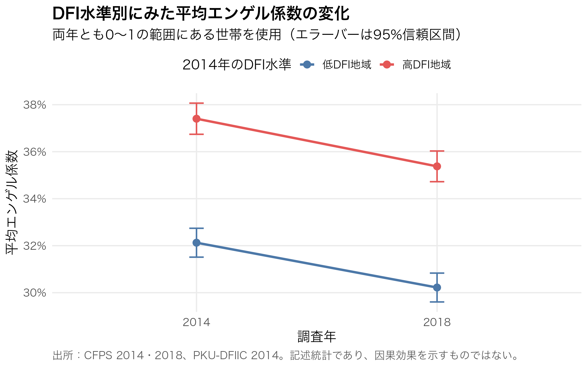
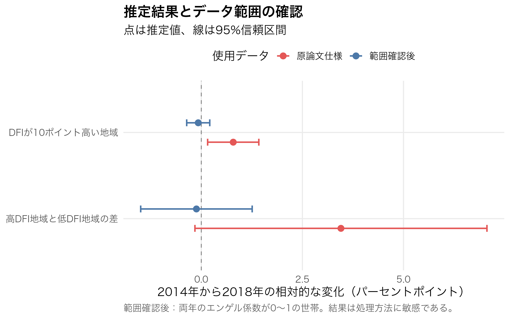

# デジタル金融包摂と中国家計の食料消費

中国の家計調査データを用い、デジタル金融が発展している地域とそれ以外の地域で、家計に占める食費の割合がどのように変化したかを分析した卒業研究です。

China Family Panel Studies（CFPS）の2014年・2018年データと、北京大学の省別デジタル金融包摂指数（DFI）を組み合わせました。Stataでデータを整理し、Rで固定効果モデルの推定、データ品質の確認、可視化を行っています。

## 3分で分かる分析概要

| 項目 | 内容 |
| --- | --- |
| 分析対象 | 2014年と2018年の両方で確認できる7,344世帯、27省級地域 |
| 確認したこと | 2014年時点のDFI水準が異なる地域で、エンゲル係数の変化に差があるか |
| エンゲル係数 | 食品支出 ÷ 総消費支出。家計支出に占める食費の割合 |
| 分析方法 | 世帯ごとの変わらない特徴と、全国共通の年次変化を考慮したDID型の固定効果比較 |
| 使用ツール | Stata、R、Excel |

DFI（Digital Financial Inclusion）は、モバイル決済やオンライン金融サービスがどの程度利用しやすいかを地域別に表した指数です。本研究では、政策前の地域差を表す基準として2014年のDFIを使用しています。

## 主な結果とデータ確認

原論文と同じ仕様では、`DFI × 2018` の係数は **0.00079（p = 0.016）** でした。DFIが10ポイント高い地域では、2014年から2018年にかけたエンゲル係数の相対的な変化が約0.79パーセントポイント大きい計算です。

DFIを高・低の2群に分けた補足モデルでは、交互項は **0.03453（p = 0.060）** でした。方向は主モデルと同じですが、統計的な証拠は弱い結果です。

一方、入力データを再確認すると、エンゲル係数が理論上の範囲である0〜1を超える値が2014年に117件、2018年に131件ありました。両年とも0〜1の世帯に限定した感度分析では、どちらのモデルでも明確な差は確認できませんでした。

したがって、本プロジェクトの結論は「デジタル金融が食料消費を増加させた」という因果関係の証明ではありません。原論文の推定結果を再現できる一方、結果がデータ処理に敏感であることも確認されました。この点を含めて、データ品質の検証と慎重な結果解釈を本プロジェクトの重要な成果と位置付けています。

## 代表的な可視化

### 高DFI地域と低DFI地域の平均値の変化



両年ともエンゲル係数が0〜1の世帯を揃えた記述統計です。高DFI地域と低DFI地域のいずれでも平均値は低下しています。この図だけから因果関係を判断することはできません。

### 原論文仕様と感度分析の比較



赤は原論文と同じデータ、青は両年のエンゲル係数が0〜1の世帯を用いた推定です。処理方法によって結果が変わるため、解釈には注意が必要です。

## データ整理と分析の流れ

```text
CFPS 2014・2018の家計経済データ
        ↓
世帯ID・地域・食品支出・総消費支出を抽出
        ↓
年次間で変数名と地域コードを統一
        ↓
2014年と2018年の世帯を対応付け
        ↓
食品支出 ÷ 総消費支出でエンゲル係数を作成
        ↓
2014年の省別DFI指数を結合
        ↓
Rでデータ品質確認・固定効果推定・感度分析・可視化
```

公開しているStataファイルは、実際に行った処理を読みやすく整理した**手順説明用コード**です。CFPSでは世帯分割などにより共通IDが重複するため、原始データからそのまま実行できる完全再現コードではありません。詳しくは [`data/README.md`](data/README.md) を参照してください。

## ツールと担当した処理

- **Stata**：CFPS変数の抽出、特殊欠損値の処理、年次データの整理
- **R / tidyverse / readxl**：Excel読み込み、ワイド・ロング変換、品質確認、集計
- **R / fixest**：世帯固定効果・年次固定効果と省レベルのクラスタ標準誤差
- **R / ggplot2**：記述統計と推定結果の可視化
- **Excel**：分析用変数と結果の確認

## ファイル構成

```text
.
├── README.md
├── code/
│   ├── analysis.R
│   └── data_preparation.do
├── data/
│   └── README.md
├── docs/
│   └── research_summary.md
└── results/
    └── figures/
```

- [`code/analysis.R`](code/analysis.R)：原論文仕様、データ品質確認、感度分析、図の作成
- [`code/data_preparation.do`](code/data_preparation.do)：Stataで行った処理の公開用概要
- [`data/README.md`](data/README.md)：データ出所、変数、サンプル、公開上の制約
- [`docs/research_summary.md`](docs/research_summary.md)：分析設計と結果の詳細

## Rコードの実行方法

CFPSの利用条件に従って作成した分析データを `data/analysis_data.xlsx` に配置し、リポジトリのルートから実行します。

```r
source("code/analysis.R")
```

別の場所に保存したデータを使う場合は、環境変数で指定できます。

```r
Sys.setenv(ANALYSIS_DATA = "/path/to/analysis_data.xlsx")
source("code/analysis.R")
```

必要なパッケージは `tidyverse`、`fixest`、`readxl`、`modelsummary` です。個票データと作成済み分析データは、利用条件とプライバシー保護のため公開していません。

## 解釈上の制約

- 2014年と2018年の2時点のみで、政策前の平行トレンドを検証できません。
- `Post` は2018年を表す時点ダミーで、単独で特定政策の外生的効果を保証するものではありません。
- DFIは省レベルの指標であり、省内の都市・農村差を直接表しません。
- 食品宅配や高付加価値食品などの具体的な消費経路は、本データでは直接検証していません。
