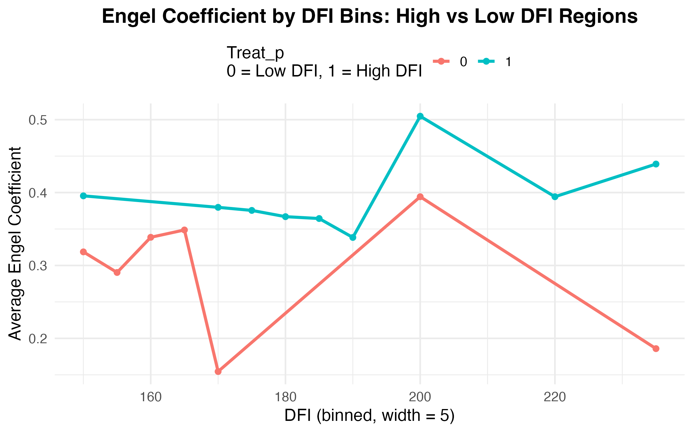

# Digital Financial Inclusion and Food Consumption in China

## プロジェクト概要

本リポジトリは、卒業論文「デジタル金融包摂が中国の食料消費に与える影響」を、データ分析ポートフォリオとして整理したものです。

China Family Panel Studies（CFPS）の 2014 年・2018 年家計データと、省別のデジタル金融包摂指数（DFI）を組み合わせ、デジタル金融の発展水準と家計のエンゲル係数の変化を分析しました。分析には差分の差分法（Difference-in-Differences, DID）を用い、世帯固定効果と年次固定効果を考慮しています。

## データと分析フロー

使用したデータは、CFPS の家計経済データと北京大学デジタル金融研究センターの省別 DFI 指数です。CFPS の利用条件とプライバシー保護のため、個票データおよび作成済み分析データは公開していません。

データ整理から分析までの流れは次のとおりです。

```text
CFPS 2014・2018
        ↓
必要な家計 ID・地域・食品支出・総消費支出を抽出
        ↓
CFPS の特殊欠損値を処理し、変数名を年次間で統一
        ↓
共通世帯 ID（fid10）で 2 時点を対応させ、パネルデータを作成
        ↓
食品支出 ÷ 総消費支出によりエンゲル係数を作成
        ↓
省をキーとして 2014 年の DFI 指数を結合
        ↓
Post・Treat_p を作成し、DID 推定と可視化を実施
```

データ整理の詳細と最終分析データの項目は [`data/README.md`](data/README.md) に記載しています。

## 分析方法と主要変数

主推定では、2014 年時点の省別 DFI 指数と政策後ダミー `Post` の交互項に注目します。

```text
Engel_it = β(DFI_i × Post_t) + household fixed effects
           + year fixed effects + error_it
```

- `Engel`：食品支出を総消費支出で割ったエンゲル係数
- `DFI`：2014 年時点の省別デジタル金融包摂指数
- `Post`：2018 年を 1、2014 年を 0 とする政策後ダミー
- `Treat_p`：DFI 水準を高・低に分けた二値変数
- `ID`：世帯 ID
- `Province`：標準誤差のクラスタリングに使用する省

主モデルでは DFI を連続変数として使用し、補足モデルでは `Treat_p × Post` を用いて結果の方向を確認しました。推定には世帯固定効果と年次固定効果を導入し、標準誤差は省レベルでクラスタリングしています。

## 主な結果

原論文の主推定では、`DFI × Post` の係数は正で、統計的に有意でした。DFI を二値化したモデルでも、`Treat_p × Post` は同じ正の方向を示しました。

この結果は、DFI 水準の高い地域では政策後のエンゲル係数が低 DFI 地域と比べてやや高めに維持される傾向を示しています。デジタル金融の発展が、オンライン食品購入、外食、食品デリバリー、高付加価値食品などを通じた食品消費の質的拡大と関係している可能性が示唆されます。

## 可視化

### DFI 区間別の平均エンゲル係数（2014 年・2018 年）



### 高 DFI 地域と低 DFI 地域の比較



## 使用技術

- **Excel**：CFPS・DFI データの整理、確認、分析用データの作成
- **R / tidyverse / readxl**：分析データの読み込み、整形、確認
- **R / fixest**：固定効果を含む DID 推定
- **R / modelsummary**：回帰結果の整理
- **R / ggplot2**：分析結果の可視化

## ファイル構成

```text
.
├── README.md
├── code/
│   └── analysis.R
├── data/
│   └── README.md
├── docs/
│   └── research_summary.md
└── results/
    └── figures/
```

- `code/analysis.R`：データ整形、DID 推定、補足モデル、可視化
- `data/README.md`：分析データの作成方法と変数定義
- `docs/research_summary.md`：研究背景・設計・結果の要約
- `results/figures/`：R で作成した図

## 実行方法

利用許可を得た分析データを `data/analysis_data.xlsx` として配置し、リポジトリのルートから次を実行します。

```r
source("code/analysis.R")
```

実行すると DID の推定結果が表示され、図が `results/figures/` に保存されます。必要な R パッケージは `tidyverse`、`fixest`、`readxl`、`modelsummary` です。
