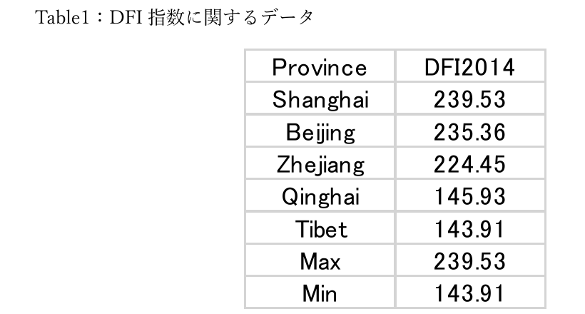

# デジタル金融包摂と中国の食料消費

## プロジェクト概要

中国におけるデジタル金融の普及と、家計の食料消費との関係を分析したプロジェクトです。

China Family Panel Studies（CFPS）の 2014 年・2018 年家計データと、省別のデジタル金融包摂指数（DFI）を組み合わせました。食品支出が総消費支出に占める割合（エンゲル係数）に注目し、デジタル金融の発展水準によって、その変化にどのような違いがあるかを調べています。

中国では、モバイル決済やオンライン金融サービスの利用が急速に広がりました。本研究では、2016 年に全国的なデジタル金融包摂政策が推進されたことを一つの区切りとし、政策前の 2014 年と政策後の 2018 年を比較しています。

## 分析方法：差分の差分法（DID）

本プロジェクトでは、差分の差分法（Difference-in-Differences, DID）を使用しました。

DID は、ある時点の数値を比べるだけでなく、政策前後の変化をグループ間で比較する方法です。ここでは、2014 年から 2018 年にかけたエンゲル係数の変化が、DFI 水準によってどのように異なるかを分析しました。

分析には、卒業論文で設定した次の回帰式を使用しています。

$$
Engel_{i,t} = \alpha + \beta (DFI_p \times Post_t) + \gamma_i + \lambda_t + \varepsilon_{i,t}
$$

- `Engel`：食品支出 ÷ 総消費支出で計算したエンゲル係数
- `DFI`：2014 年時点の省別デジタル金融包摂指数
- `Post`：2018 年を 1、2014 年を 0 とする変数
- `Treat_p`：DFI 水準を高・低の 2 グループに分けた変数
- `DFI_p × Post_t`：DFI 水準によって政策前後の変化がどの程度異なるかを表す交互項
- `γ_i`：世帯ごとに変わらない特徴を考慮する世帯固定効果
- `λ_t`：景気など全国共通の変化を考慮する年次固定効果

R の `fixest` を用いて世帯固定効果と年次固定効果を設定し、標準誤差は省レベルでクラスタリングしました。DFI を連続値として用いる分析に加え、高 DFI 地域と低 DFI 地域に分けた比較も行っています。

## 使用データと整理の流れ

使用したデータは、CFPS の家計経済データと北京大学デジタル金融研究センターの省別 DFI 指数（PKU-DFIIC）です。DFI 指数は、金融サービスのカバレッジ、利用の深さ、デジタル化水準を組み合わせた指標です。

両年で確認できる 7,344 世帯を対応させ、14,688 世帯年のパネルデータとして分析しました。2020 年以降は新型コロナウイルスによる食品消費への影響が大きいため、今回の分析には含めていません。

エンゲル係数は、次の式で作成しました。

$$
Engel_{i,t} = \frac{FoodExp_{i,t}}{TotalExp_{i,t}}
$$

1. 2014 年・2018 年の CFPS から、世帯 ID、地域、食品支出、総消費支出を抽出
2. 欠損値を処理し、年によって異なる変数名を統一
3. 共通世帯 ID（`fid10`）で両年の世帯を対応させ、パネルデータを作成
4. 食品支出を総消費支出で割り、各年のエンゲル係数を作成
5. 省をキーとして DFI 指数を結合し、R で分析できる形式に整理

2014 年の DFI 指数には大きな地域差があり、卒業論文で整理したデータでは最大値 239.53、最小値 143.91 でした。



CFPS の利用条件とプライバシー保護のため、個票データと作成済み分析データは公開していません。変数定義と整理手順は [`data/README.md`](data/README.md) に記載しています。

## 分析結果

分析結果は次のとおりです。

| 分析 | 交互項の係数 | p 値 | 結果 |
| --- | ---: | ---: | --- |
| DFI を連続値として使用 | 0.00079 | 0.016 | 正の関係、5％水準で有意 |
| 高 DFI・低 DFI の 2 グループで比較 | 0.0345 | 0.060 | 同じ正の方向、10％水準で有意 |

この結果から、デジタル金融の発展水準が高い地域ほど、政策後にエンゲル係数が相対的に高くなる傾向が示されました。オンラインでの食品購入、外食、フードデリバリー、高付加価値食品などへのアクセスが広がり、食品消費が多様化した可能性があります。

## 可視化

### DFI 水準別に見たエンゲル係数の変化

2014 年と 2018 年について、DFI の水準ごとに平均エンゲル係数を比較しています。


### 高 DFI 地域と低 DFI 地域の比較

DFI 水準を 2 グループに分け、それぞれの平均エンゲル係数を比較しています。


## 使用ツール

- Excel：CFPS・DFI データの整理、確認、分析用データの作成
- R / tidyverse / readxl：データの読み込み、整形、集計
- R / fixest：DID 分析
- R / modelsummary：分析結果の整理
- R / ggplot2：グラフの作成

## ファイル構成

```text
.
├── code/
│   └── analysis.R            # データ整形・DID 分析・可視化
├── data/
│   └── README.md             # データ整理手順と変数定義
├── docs/
│   └── research_summary.md   # 研究内容の要約
└── results/
    └── figures/              # R で作成したグラフ
```
